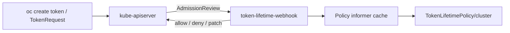

# Token Lifetime Filtering Webhook

## Goal

A focused Go admission webhook that intercepts `CREATE` on `serviceaccounts/token` and enforces a **singleton** `TokenLifetimePolicy` named `cluster`, either **denying** over-limit requests or **mutating** `expirationSeconds` down to the configured max. Optional namespace glob exemptions skip enforcement for matching namespaces. OAuth tokens are out of scope (OpenShift webhook-restricted).

## Architecture



**Decision flow:**
1. Read the singleton `TokenLifetimePolicy` named `cluster`
2. If it does not exist → allow unchanged
3. If request namespace matches `spec.exemptNamespaces` → allow unchanged (exempt)
4. Parse `spec.maxExpiration` to seconds (invalid duration → fail closed with a clear message)
5. If requested `expirationSeconds` ≤ max → allow
6. If over limit and `onExceed=Mutate` → allow with JSON patch setting `spec.expirationSeconds` to the parsed max
7. If over limit and `onExceed=Deny` → reject with a clear message
8. Ignore any `TokenLifetimePolicy` objects not named `cluster` (log a warning if seen)
9. Fail closed on decode/eval errors when the singleton exists and the namespace is not exempt (`failurePolicy: Fail`)

Use a single **mutating** webhook (can return patches or set `allowed: false`).

## CRD: `TokenLifetimePolicy`

`tokenfiltering.openshift.io/v1alpha1` — cluster-scoped **singleton**. Canonical name: `cluster` (OpenShift config convention).

```yaml
apiVersion: tokenfiltering.openshift.io/v1alpha1
kind: TokenLifetimePolicy
metadata:
  name: cluster
spec:
  maxExpiration: 1y          # human-readable; default 1y
  onExceed: Mutate           # Deny | Mutate  (default: Deny)
  exemptNamespaces:          # optional globs; omit/empty = no exemptions
    - openshift
    - openshift-*
    - kube-*
```

**Duration field (`maxExpiration`):**
- Type: string
- Default when omitted / empty: `1y` (365 days = `31536000` seconds)
- Accepted units (Go-style, case-insensitive): `s`, `m`, `h`, `d`, `w`, `y`
  - Examples: `3600s`, `60m`, `24h`, `7d`, `1y`, compound `1h30m`
- Parser lives in `pkg/policy` (or `pkg/duration`); not `time.ParseDuration` alone (no `d`/`w`/`y`)
- Comparisons and JSON patches always use integer seconds against `TokenRequest.spec.expirationSeconds`

**Namespace exemptions (`exemptNamespaces`):**
- Type: `[]string` of shell-style globs (`path.Match` semantics: `*`, `?`, character classes)
- Omit or empty list → **no exemptions**; policy applies to all namespaces
- Non-empty → if the request namespace matches **any** entry, skip enforcement (allow)
- No match → enforce as usual
- No SA targeting
- Recommended OpenShift starting point (shipped in the primary sample, **not** as a CRD schema default so empty stays “no exemptions”):
  - `openshift` — bare platform namespace (`openshift-*` does not match it)
  - `openshift-*` — platform operands/operators
  - `kube-*` — `kube-system`, `kube-public`, `kube-node-lease`
- Do **not** exempt `default` or normal user namespaces

Enforcement:
- Only `metadata.name: cluster` is honored
- CRD CEL: `self.metadata.name == 'cluster'` so non-singleton names are rejected by the API

Samples in `config/samples/`:
- Primary `cluster` policy with OpenShift builtin exemptions above
- Additional Deny / Mutate / custom-exempt examples as needed

## Project layout

```
/
├── api/v1alpha1/          # TokenLifetimePolicy types + deepcopy + CRD YAML
├── cmd/webhook/main.go    # entrypoint
├── pkg/
│   ├── webhook/           # AdmissionReview handler, deny / JSON-patch
│   └── policy/            # singleton reader, duration parse, exempt ns globs, evaluator
├── config/
│   ├── crd/
│   ├── deploy/            # Namespace, SA, RBAC, Deployment, Service, MWC
│   └── samples/           # deny / mutate / exempt-ns example policies
├── Dockerfile
├── Makefile
├── go.mod
└── README.md
```

Research artifacts already in the repo (kubeconfigs, logs, htpasswd) stay untracked via `.gitignore`; they are not part of the product.

## Implementation details

### Webhook handler (`pkg/webhook`)

- Decode `admissionv1.AdmissionReview`
- Only handle `CREATE` on `v1/serviceaccounts` subresource `token`
- Unmarshal into `authenticationv1.TokenRequest`
- Pass request namespace + `expirationSeconds` into evaluator
- Switch on result:
  - **Allow** — `allowed: true` (includes exempt namespace / under limit / no policy)
  - **Deny** — `allowed: false` + message (`requested Xs exceeds max Ys`)
  - **Mutate** — `allowed: true` + base64 JSON patch replacing `/spec/expirationSeconds`
- Log ns/sa/requested/max/mode/exempt

### Policy controller (`pkg/policy`)

- Informer or Get for `TokenLifetimePolicy/cluster` only
- Duration parser: human-readable → seconds; default `1y` when field empty
- Exempt matcher: `path.Match` over `spec.exemptNamespaces`; empty → enforce everywhere; any match → allow
- Pure `Evaluate(namespace, expirationSeconds, policy) Decision` — allow | deny | mutate(+value)

### Deployment (`config/deploy`)

- Namespace `token-lifetime-webhook`
- Deployment (2 replicas), Service on `:8443`
- TLS via OpenShift service CA (Service secret injection + `service.beta.openshift.io/inject-cabundle: "true"` on the webhook config)
- RBAC: get/list/watch `tokenlifetimepolicies`
- `MutatingWebhookConfiguration` still matches all namespaces (exemptions are policy-side so globs stay dynamic without rewriting the MWC):

```yaml
rules:
  - apiGroups: [""]
    apiVersions: ["v1"]
    resources: ["serviceaccounts/token"]
    operations: ["CREATE"]
failurePolicy: Fail
sideEffects: None
admissionReviewVersions: ["v1"]
reinvocationPolicy: IfNeeded
```

### Ops surface

- Flags: `--tls-cert`, `--tls-key`, `--listen`, `--kubeconfig` (optional)
- `/healthz` and `/readyz` (ready when policy informer synced)
- Metrics: `token_lifetime_webhook_decisions_total{result=allow|deny|mutate}`, latency histogram

### Tests

- Unit: duration parser — `s`/`m`/`h`/`d`/`w`/`y`, compounds, invalid input, empty → `1y`
- Unit: exempt namespace globs — empty/none, exact, `openshift-*`, match → allow, no match → enforce, invalid pattern error handling
- Unit: evaluator — missing policy allows; Deny/Mutate over and under limit; exempt ns skips enforcement
- Unit: webhook — deny response; mutate JSON patch; allow path
- Unit: non-`cluster` policy objects are ignored by the reader
- Makefile: `test`, `build`, `docker-build`, `deploy`

### Docs

- README: singleton `cluster`, duration units, default `1y`, exempt namespace globs (sample defaults: `openshift`, `openshift-*`, `kube-*`), Deny vs Mutate, install, samples, verify with `oc create token ... --duration=...`, limitations (not a substitute for `--service-account-max-token-expiration`; no OAuth coverage)

## Defaults locked in

- Language: Go with client-go informers + admission HTTP server; `controller-gen` for CRD/deepcopy
- Image: distroless static binary
- No Helm/OLM in v1; plain `kubectl apply -k` / `oc apply`
- CRD default for `maxExpiration`: `1y`
- CRD default for `onExceed`: `Deny`
- `exemptNamespaces` omit/empty = no exemptions (enforce everywhere); match = allow
- Sample/recommended exemptions: `openshift`, `openshift-*`, `kube-*` (not a CRD schema default)
- Glob implementation: `path.Match`
- Singleton name: `cluster`
